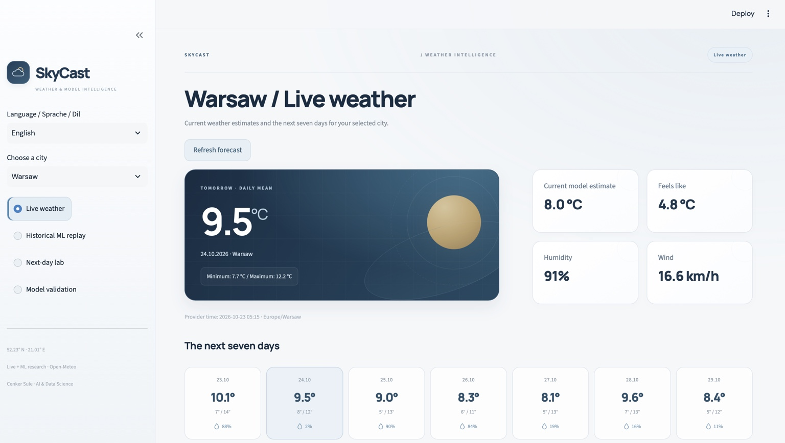

# SkyCast · Next-Day Temperature Lab

[Deutsch](README.md) | **English** | [Türkçe](README.tr.md)

A reproducible machine-learning project for **one-day-ahead mean temperature predictions in eight cities**: Warsaw, Istanbul, Berlin, Paris, London, Rome, Madrid and Ankara.

**Author:** Cenker Sule · Artificial Intelligence & Data Science

## Application preview



*Captured on 23 October 2026. The running app retrieves up-to-date values from Open-Meteo.*


## Live weather forecasts

The default view now shows current model-based weather estimates and a **seven-day forecast** from the Open-Meteo Forecast API for all eight cities. Dates use each city’s local timezone. Responses are cached for up to 30 minutes and can be refreshed manually. Internet is required for this view. Provider errors are shown explicitly; historical predictions are never substituted as current forecasts.

**Historical ML replay**, Next-day lab and Model validation remain separate. Live forecasts come from the weather provider, not the project’s fitted Ridge/gradient-boosting models. All metrics below refer exclusively to the historical ML experiment.

[Open-Meteo Forecast API](https://open-meteo.com/en/docs) · [CC BY 4.0](https://creativecommons.org/licenses/by/4.0/)


## Start in a minute

Start Docker Desktop, then run inside this project folder:

```bash
docker compose up --build
```

Open [http://localhost:8502](http://localhost:8502). Port 8502 lets CreditLens continue on 8501. Data and fitted models are included; only the initial Docker build needs internet. Stop with `Ctrl+C`, then `docker compose down`.

## Features

- Historical forecast replay with actual ERA5 daily means and a calibration band.
- Upload a CSV history to estimate its next local calendar day.
- City comparisons, seasonality, MAE/RMSE and monthly errors.
- Ridge regression and gradient boosting compared with persistence and seasonal means.
- English, German and Turkish interface; English is the default.
- Chronological evaluation, input validation, automated tests and Docker.

## Measured results

Held-out test: **2024–2025, 731 days per city**, **5,848 predictions** in total. Selection uses validation MAE from 2021–2022 only. Persistence predicts the next day using the last complete day’s temperature. Lower MAE is better.

| City | Selected model | MAE °C | Persistence MAE °C | Improvement | Test band coverage |
| --- | --- | ---: | ---: | ---: | ---: |
| Warsaw | Gradient boosting | 1.553 | 1.712 | 9.3% | 91.9% |
| Istanbul | Gradient boosting | 0.815 | 0.957 | 14.8% | 94.5% |
| Berlin | Gradient boosting | 1.538 | 1.766 | 12.9% | 90.6% |
| Paris | Gradient boosting | 1.460 | 1.679 | 13.1% | 86.6% |
| London | Ridge regression | 1.378 | 1.571 | 12.3% | 89.7% |
| Rome | Gradient boosting | 1.004 | 1.085 | 7.5% | 91.2% |
| Madrid | Gradient boosting | 1.176 | 1.381 | 14.9% | 88.6% |
| Ankara | Gradient boosting | 1.159 | 1.408 | 17.7% | 89.2% |

Improvement is against persistence, not professional weather services. Selection is per city: Ridge for London and gradient boosting elsewhere.

## Methodology

| Period | Purpose |
| --- | --- |
| 2010–2020 | Training; 4,004 examples per city after the 14-day warm-up |
| 2021–2022 | Model selection by MAE, 730 examples |
| 2023 | Interval calibration, 365 examples |
| 2024–2025 | Held-out testing, 731 examples |

The target is **daily mean air temperature at 2 metres**. The 17 predictors use completed-day weather only: lagged temperature, precipitation, wind, radiation, rolling means, temperature change and cyclical features of the target date. No random split and no target-day weather inputs.

Ridge uses training-only standardisation. Gradient boosting learns the residual over persistence. Hyperparameters are fixed; validation selects Ridge, gradient boosting or persistence separately per city. Models are not refitted on validation, calibration or test data. Earlier realised test-day weather is available for successive retrospective one-day predictions; this is not a recursive multi-day forecast.

Each city’s symmetric band uses the finite-sample absolute residual quantile on 2023 calibration data, targeting 90% coverage. Temporal dependence and drift mean **future 90% coverage is not guaranteed**; empirical test coverage is reported above.

## Data and limitations

**Open-Meteo Historical Weather API**, explicitly requesting `era5`, with daily data from 1 January 2010 to 31 December 2025 in each city’s local timezone. Underlying source: ECMWF / Copernicus Climate Change Service ERA5. Values represent a grid cell at fixed city coordinates, not a specific weather station.

[Open-Meteo / ERA5 documentation](https://open-meteo.com/en/docs/historical-weather-api) · [CC BY 4.0](https://creativecommons.org/licenses/by/4.0/)

**The custom ML section is a retrospective research demo.** ERA5 arrives with a publication delay and uses information assimilated retrospectively. The experiment assumes idealised access to earlier weather values; it does not establish operational real-time forecast accuracy. The bundled CSV ends on 31 December 2025, so its next-day prediction is for 1 January 2026. The custom ML models predict only daily mean temperature, not rainfall or other weather outcomes.

## Python and reproducibility

Python 3.12:

```bash
python3.12 -m venv .venv
source .venv/bin/activate
python -m pip install -r requirements-dev.txt
python -m pip install --no-deps -e .
python -m streamlit run app.py --server.port=8502
```

Retrain from bundled data and run tests:

```bash
python -m skycast.train
python -m pytest -q
```

Optional download: `python -m skycast.data` fetches missing city CSVs and reuses existing ones. For a complete refresh, first back up and remove the eight city CSVs from the project. API limits and retrospective ERA5 revisions may apply. `data/provenance.json` records request URLs, dates and hashes; `artifacts/report.json` records partitions, validation choices and metrics.

**Validation:** 28 local tests passed, covering future-data invariance, invalid histories, reproduced held-out metrics and chronological partitions for eight cities, and all three views in three languages. The Streamlit server was also checked through its health endpoint. Docker and GitHub Actions are configured; their builds/runs have not been executed in this environment.

## Structure

| Path | Purpose |
| --- | --- |
| `app.py` | Interactive dashboard |
| `src/skycast/data.py` | Data source, city definitions and input checks |
| `src/skycast/features.py` | Time-safe feature construction |
| `src/skycast/train.py` | Fitting, selection, intervals and evaluation |
| `src/skycast/ui.py` | Translations and design |
| `data/` | Daily ERA5 records and provenance |
| `artifacts/` | Fitted models, evaluation report and test predictions |
| `tests/` | Model and application tests |

Code: MIT. Weather data: CC BY 4.0 with attribution above.
